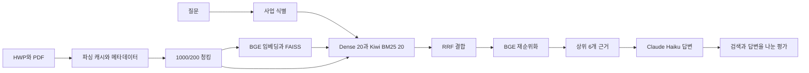

# 제안요청서에서 근거를 찾아 답하는 RAG 프로젝트

공공 입찰 제안요청서(RFP) 100건에서 질문과 관련된 근거를 찾아 한국어로 답합니다. HWP·PDF에서 글과 표를 읽고, 긴 문서를 나눈 뒤 검색한 근거를 Claude Haiku에 전달합니다. 요구사항·예산·일정처럼 문서에 흩어진 정보를 확인하는 것이 목표입니다.

현재 실행 코드는 **FINAL-02 하나**입니다. 2026년 10월 20일 사용자의 최종 선택을 반영했습니다. 과거 구성은 아래 시도 이력과 Git 이력에 남기고 기본 실행에서는 제거했습니다. 이 선택은 새로운 모델 평가 결과나 통계적 우월성의 증명을 뜻하지 않습니다.

## 목차

- [프로젝트 구조](#프로젝트-구조)
- [설치와 실행](#설치와-실행)
- [최종 선정 이유](#최종-선정-이유)
- [어떤 시도를 했나요](#어떤-시도를-했나요)
- [결과와 한계](#결과와-한계)
- [보고서와 발표](#보고서와-발표)
- [팀원별 협업일지](#팀원별-협업일지)
- [출처와 공개 범위](#출처와-공개-범위)

## 프로젝트 구조



사업을 식별하지 못하거나 여러 사업이 모호하게 걸리면 전체 문서에서 검색합니다. FINAL-02에는 사업명 청크 헤더와 질문 분해를 사용하지 않습니다.

| 경로 | 하는 일 |
|---|---|
| `rfp_rag/config.py` | 최종 모델과 검색 설정 |
| `parsing.py`, `data.py` | HWP·PDF·캐시 읽기, 평가셋·메타데이터 검증 |
| `chunking.py`, `embedding.py` | 문서 분할과 BGE 임베딩 연결 |
| `routing.py`, `retrieval.py` | 사업 식별, Dense·Kiwi BM25·RRF 검색 |
| `reranking.py` | BGE로 검색 후보의 순서 조정 |
| `generation.py`, `pipeline.py` | 원본 프롬프트로 답변 생성·캐시·결과 기록 |
| `metrics.py`, `evaluation.py`, `experiments.py` | 근거 순위·포함률, Gemini Judge, RAGAS·체크포인트 |
| `prompts/final02.txt` | 제공된 FINAL-02 프롬프트 원문 |
| `tests/` | 네트워크 없는 합성 검증 |
| `docs/` | 최종 기술 리포트, 집계 결과, 출처와 과거 시도 |

표에서 파일명만 적은 모듈은 `rfp_rag/` 아래에 있습니다.

## 설치와 실행

Python 3.11 이상을 기준으로 합니다. 아래 설치는 사용자가 실행할 절차입니다. 이번 정리에서는 설치·모델 다운로드·유료 API를 실행하지 않았습니다. GPU 환경과 고정 패키지 조합의 새 설치 호환성은 별도 확인이 필요합니다.

```sh
python -m venv .venv
# Windows: .venv\Scripts\activate
# Linux/macOS: source .venv/bin/activate
python -m pip install -r requirements.txt
# 원본 재현 가이드가 지정한 별도 설치 방법
python -m pip install --no-deps langchain-hwp-hwpx-loader==0.1.1
```

`.env.example`을 참고해 로컬 `.env`에 본인의 `ANTHROPIC_API_KEY`, `GOOGLE_API_KEY`를 설정합니다. 키를 README·이슈·커밋에 적지 않습니다. `summary`, `check`, `--help`는 키를 읽거나 모델을 시작하지 않습니다.

원본 제공자에게 허가받은 다음 자료를 별도로 준비합니다. 이 저장소에는 문서·메타데이터 행·평가 질문·답변·벡터가 없습니다.

```text
data/
  data_list.csv
  dev_benchmark_v1.1.json
  raw/files/                    # HWP·PDF 100건
    parsed_results/success_files.json
```

같은 실험을 재현하려면 제공된 파싱 캐시를 사용해야 합니다. 다시 파싱하면 본문과 청크 수가 달라질 수 있습니다. `ask`도 원본과 같은 100문서 선택을 위해 비공개 평가셋과 메타데이터를 사용합니다.

```sh
# 실제 모델을 사용한 질문: 임베딩 모델·리랭커를 받고 생성 API를 호출할 수 있습니다.
python -m rfp_rag ask --query "이 사업의 주요 요구사항을 설명해 줘."

# 검색·답변·Judge를 앞 3문항만 실행: 유료 호출이 있는 실행 시험입니다.
python final02.py base --limit 3 --out-dir results/FINAL-02-test

# 전체 재평가는 호출량과 예산을 확인한 뒤 별도로 실행합니다.
python final02.py base
python final02.py ragas
python final02.py summary

# 설치·모델·API 없이 실행하는 검증
python -B -m unittest discover -s tests -v
python -B -m rfp_rag check
```

`--data-dir`, `--metadata-csv`, `--benchmark`, `--out-dir`로 경로를 지정할 수 있습니다. 원본의 문항별 체크포인트와 다른 설정의 결과 폴더 재사용 차단을 유지했습니다. 청크·프롬프트를 바꾸면 새 결과 폴더를 사용하세요. RAGAS는 지표마다 새 Gemini 클라이언트를 만들어 원본의 이벤트 루프 처리를 유지합니다.

임베딩과 리랭커 로더는 원본의 `trust_remote_code` 설정을 유지합니다. 실제 모델 다운로드·실행 전에는 해당 모델 revision과 제공 코드를 검토해야 합니다. 이번 모의 테스트에서는 로더를 실행하지 않았습니다.

## 최종 선정 이유

FINAL-01과 FINAL-02의 기존 300문항 비교에서 답변 점수 차이가 통계적으로 유의하지 않다고 기록돼 있습니다. FINAL-02는 문항당 입력 문맥이 약 27% 짧고, 기록된 검색 시간 중앙값이 4.9초에서 약 1.7초로 작았습니다. 질문 분해 호출이 추가되지 않는 단순한 실행 구성을 선택했습니다.

이는 두 구성의 성능이 같다고 입증한 결과가 아닙니다. 여러 절에 흩어진 근거를 모으는 질문에서는 FINAL-01이 더 많은 근거를 확보한 기록도 있습니다. 자세한 조건과 한계는 [최종 기술 리포트](docs/기술리포트.md)를 읽어 주세요.

## 어떤 시도를 했나요

| 흐름 | 시도와 발견 | 최종 정리 |
|---|---|---|
| 초기 `07_verify` | KURE·Chroma·EXAONE, 질문 분기와 숫자 검증을 포함한 초기 실행 구조 | 이전 평가 조건의 기준으로 보존 |
| 기존 Version 1·2 | 사업 식별·700/100·BGE·FAISS·Kiwi BM25 등 팀원 구현을 비교 | FINAL-02와 동일한 구성으로 취급하지 않음 |
| 기존 Version 3·4 | HWP 보정·parent/child·OpenAI 또는 KoE5 검색 흐름을 접수 | 실제 확보한 코드와 평가한 성능의 범위를 구분 |
| 10문서·30문항 실험 | 임베딩·프롬프트·리랭커·청크 크기를 바꾸며 검색과 답변을 분리해 확인 | 작은 실험의 결과를 100문서 결과와 섞지 않음 |
| 100문서·300문항 검색 실험 | 더 큰 검색 범위에서 근거 누락과 문맥 길이를 확인 | 검색 전용 결과를 답변 정확도로 표현하지 않음 |
| FINAL-01 | parent/child·질문 분해, 흩어진 근거 수집에 강점 | 비교 근거로 보존 |
| FINAL-02 | 헤더·질문 분해 없이 1000/200·BGE 재순위·Haiku 생성 | 현재 기본 실행으로 채택 |

<details>
<summary>과거 문서와 고정 코드 보기</summary>

[시도와 평가 해석](docs/시도와선정.md) · [과거 문서 보관](docs/history/README.md) · [교체 전 고정 코드](https://github.com/mingilee97/rag-project-part3-2team-main/tree/0f77930191bcb5d5b12c13a8d52d08184154c2f6)

구버전 실행 코드는 현재 트리에서 제거했고 Git 이력은 보존합니다. 원본 문서·출처·고정 SHA·기존 권리표시는 과거 문서에서 계속 확인할 수 있습니다.

</details>

## 결과와 한계

아래는 제공된 FINAL-02 저장 결과를 재계산한 값입니다. 새로 모델을 실행한 결과가 아닙니다.

| 지표 | 결과 | 유효 문항 수 |
|---|---:|---:|
| Hit@5 | 0.9550 | 289 |
| MRR | 0.8618 | 289 |
| Gemini LLM-as-Judge | 0.9300 | 300 |
| Factual Correctness F1 | 0.5749 | 300 |
| Faithfulness | 0.9848 | 300 |
| 필요한 근거를 모두 전달 | 252/300 | 300 |
| 평균 문맥 길이 | 5,079.2167자 | 300 |
| 검색 시간 중앙값 | 1.704초 | 300 |

근거 문장이 청크에 연결되지 않은 11문항은 검색 순위 평균에서 제외합니다. 점수가 없는 문항을 0점으로 바꾸지 않았습니다. FINAL-01의 parent 순위와 FINAL-02의 일반 청크 순위를 그대로 비교하지 않습니다. 한 번의 기존 실행, LLM 채점, 파싱 캐시 차이 때문에 일반적인 우월성과 재현성을 단정할 수 없습니다.

이번 정리의 검증은 합성 테스트 12개, 원본 대비 답변·캐시 비교 6건, 함수·클래스 구조 23개 일치, 프롬프트 바이트 일치입니다. 실제 모델·GPU·API·전체 재평가는 하지 않았습니다. [검증 근거](docs/validation.json)

## 보고서와 발표

- [최종 기술 리포트 PDF 다운로드](docs/FINAL02_최종기술리포트.pdf)
- [기술 리포트 편집 원문](docs/기술리포트.md) · [브라우저용 리포트](docs/FINAL02_최종기술리포트.html)
- [설정](docs/final02-settings.json) · [집계 CSV](docs/final02-summary.csv) · [출처와 변경](docs/출처와변경.md)
- [기존 중간발표 자료](presentations/README.md): EXAONE 시기 자료이며 FINAL-02 성능 발표로 해석하지 않습니다.

별도 최신 발표의 호스팅·접근 권한은 이 코드 제출 작업에서 변경하지 않았습니다.

## 팀원별 협업일지

GitHub에서는 Notion 데이터베이스 탭 대신 목차·개인별 표·접기 구조로 바로 이동할 수 있게 했습니다. 팀원의 원문은 수정하지 않았습니다.

| 팀원 | 확인된 원본 링크 | 확인 범위 |
|---|---|---|
| 이민기 | [개인 협업일지 시트](https://docs.google.com/spreadsheets/d/1sWL-WgSjILLUkuB_yw3edxLnqOATh7gCUG410d-JvrA/edit#gid=2053649411) | 기존 개인 탭, 별도 담당자가 최근 기록을 정리한 원본 |
| 김현경 | [데일리 협업일지](https://app.notion.com/p/3eb67f39201180a4b1dbec087503807a?v=3eb67f39201180d583d7000c73a17268) · [실험 문서](https://app.notion.com/p/3ec67f3920118072b687d3aaed1e4428) | 일지 본문에서 작성자 확인, 현재 게스트 열람 확인 |
| 김민협 | [기존 개인 시트](https://docs.google.com/spreadsheets/d/1sWL-WgSjILLUkuB_yw3edxLnqOATh7gCUG410d-JvrA/edit#gid=924303621) | 탭 출처 확인, 최신 개인 원문 여부는 확인 필요 |
| 이원영 | [기존 개인 시트](https://docs.google.com/spreadsheets/d/1sWL-WgSjILLUkuB_yw3edxLnqOATh7gCUG410d-JvrA/edit#gid=1041212623) | 탭 출처 확인, 최신 개인 원문 여부는 확인 필요 |
| 권유진 | [기존 개인 시트](https://docs.google.com/spreadsheets/d/1sWL-WgSjILLUkuB_yw3edxLnqOATh7gCUG410d-JvrA/edit#gid=1632189499) | 탭 출처 확인, 최신 개인 원문 여부는 확인 필요 |

<details>
<summary>원본 접근과 VM 종료 후 보존</summary>

위 링크의 익명·평가자 접근은 별도 확인이 필요합니다. 공개 설정·초대·권한은 변경하지 않았습니다. 김현경 Notion은 현재 게스트 내보내기가 비활성이라 작성자의 내보낸 HTML/Markdown/PDF가 필요합니다. [일지 보존 안내](docs/협업일지와보존.md)

VM 대시보드 링크만 남기지 않습니다. 개인별 원본 링크와 정적 보존본, 이미지·첨부·날짜·작성자·출처를 함께 남겨야 합니다. 현재 VM과 로컬의 최신 자료가 동기화됐는지는 확인되지 않았습니다.

</details>

## 출처와 공개 범위

FINAL-02 실행은 이원영 님의 제공 묶음이며, 재현 가이드는 김현경 님 `final_pipeline`의 `7db81eb`을 사용했다고 적습니다. 이 짧은 SHA의 원격 전체 commit은 별도로 확인하지 못했습니다. 사용자 제공 원본의 해시와 실제 모듈화 범위는 [출처와 변경](docs/출처와변경.md), [원본 파일 해시](docs/source-manifest.json)에 남겼습니다. 원본에 없던 일반 오픈소스 라이선스는 붙이지 않았습니다.

공개 파일은 코드·빈 설정 예시·집계값·작성 문서·확인된 링크입니다. RFP 원문·파싱 본문·메타데이터 행·평가 질문·답변·문맥·벡터·가중치·개인 환경은 포함하지 않습니다. 다른 작업에서 관리하는 운영 VM·modular 저장소·협업일지 원본은 이 변경의 대상이 아닙니다.
